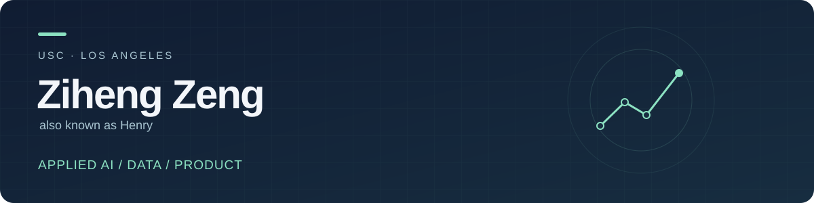

I'm **Ziheng (Henry) Zeng**, a student at the **University of Southern California**, based in Los Angeles. I'm interested in making AI useful through thoughtful products and measurable results.

### Areas of interest

| Applied AI | Data | Product |
| :--- | :--- | :--- |
| LLM evaluation and agent workflows | Product analytics and predictive modeling | User problems, prototyping, and iteration |

### Featured project

**[LEGO_PET · Lechai 乐柴](https://github.com/goupaishalujiqi/LEGO_PET)**  
A brick-style animated Shiba Inu companion for the Codex App, packaged with a pet manifest, spritesheet, and installation instructions for macOS, Linux, and Windows.

[View project →](https://github.com/goupaishalujiqi/LEGO_PET) · [Installation guide →](https://github.com/goupaishalujiqi/LEGO_PET#install)

### Let's connect

I'm exploring **Summer 2027 internships** in applied AI, product analytics, and data science.

[Browse my projects](https://github.com/goupaishalujiqi?tab=repositories)
